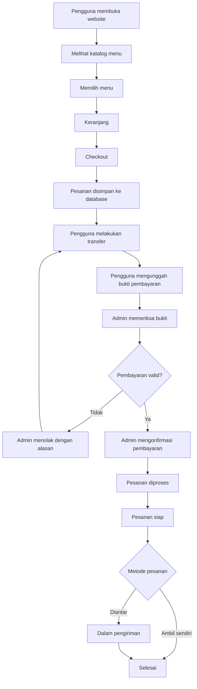

# Dapur.Go — Website Pemesanan Catering

Dapur.Go adalah aplikasi pemesanan catering berbasis web yang membantu pelanggan melihat pilihan menu, membuat pesanan, dan memantau status pemesanan. Admin dapat mengelola menu, memeriksa pembayaran, mengatur proses pesanan, serta melihat laporan transaksi.

## Daftar Isi

- [Fitur Utama](#fitur-utama)
- [Aktor dan Hak Akses](#aktor-dan-hak-akses)
- [Teknologi](#teknologi)
- [Alur Sistem](#alur-sistem)
- [Struktur Database](#struktur-database)
- [Persyaratan](#persyaratan)
- [Instalasi dan Menjalankan Project](#instalasi-dan-menjalankan-project)
- [Konfigurasi Pembayaran](#konfigurasi-pembayaran)
- [URL Halaman](#url-halaman)
- [Git dan GitHub](#git-dan-github)
- [Catatan Keamanan](#catatan-keamanan)

## Fitur Utama

### Pengguna

- Registrasi, login, dan logout.
- Melihat homepage dan katalog menu catering.
- Mencari menu serta memfilter berdasarkan kategori.
- Melihat detail menu dan harga.
- Menambahkan menu ke keranjang, mengubah jumlah, dan menghapus item.
- Checkout dengan informasi pelanggan, tanggal acara, waktu, dan metode pengiriman.
- Memilih pengiriman atau mengambil pesanan sendiri.
- Melihat ringkasan serta riwayat pesanan.
- Mengunggah bukti transfer dan melihat status pembayaran.
- Melihat perkembangan pesanan melalui tracking.
- Melihat notifikasi dan mengelola profil.

### Admin

- Login ke dashboard Admin.
- Melihat ringkasan jumlah menu, kategori, pesanan, dan pembayaran yang menunggu verifikasi.
- Mengelola kategori dan menu catering.
- Menambahkan, mengedit, mencari, memfilter, dan menghapus menu.
- Mengunggah foto menu.
- Melihat daftar dan detail pesanan pelanggan.
- Melihat bukti transfer yang diunggah pelanggan.
- Menyetujui atau menolak bukti pembayaran.
- Memperbarui status pesanan.
- Melihat laporan transaksi berdasarkan rentang tanggal.
- Melihat grafik pendapatan dan jumlah pesanan.
- Menerima notifikasi aktivitas pesanan dan pembayaran.

> **Pembayaran:** Sistem menggunakan transfer bank manual. Aplikasi mencatat pembayaran dan menyediakan verifikasi oleh Admin; integrasi payment gateway otomatis bukan bagian dari konfigurasi ini.

## Aktor dan Hak Akses

| Aktor | Hak akses |
|---|---|
| Admin | Dashboard, pengelolaan menu, kategori, pesanan, verifikasi pembayaran, laporan, dan notifikasi Admin. |
| Pengguna | Registrasi, katalog, keranjang, checkout, pembayaran, riwayat dan tracking pesanan, profil, serta notifikasi Pengguna. |

Akses halaman dibatasi menggunakan autentikasi Laravel dan middleware berdasarkan `role` (`admin` atau `user`). Registrasi publik hanya membuat akun dengan role `user`.

## Teknologi

| Teknologi | Kegunaan |
|---|---|
| PHP | Bahasa pemrograman backend |
| Laravel | Framework aplikasi web dan backend |
| MySQL | Database aplikasi |
| phpMyAdmin | Antarmuka pengelolaan database MySQL |
| Blade | Template halaman aplikasi |
| HTML, CSS, JavaScript | Antarmuka pengguna |
| Laragon | Lingkungan pengembangan lokal Windows |
| Git dan GitHub | Version control dan penyimpanan source code |

## Alur Sistem



### Status Pembayaran

| Status | Keterangan |
|---|---|
| `waiting_payment` | Menunggu pelanggan melakukan pembayaran |
| `waiting_verification` | Bukti pembayaran telah dikirim dan menunggu pemeriksaan Admin |
| `paid` | Pembayaran telah dikonfirmasi Admin |
| `rejected` | Bukti pembayaran ditolak dan pelanggan dapat mengirim ulang bukti |

### Status Pesanan

| Status | Keterangan |
|---|---|
| `pending_payment` | Menunggu pembayaran |
| `processing` | Pesanan sedang disiapkan |
| `ready` | Pesanan siap |
| `delivering` | Pesanan sedang diantar |
| `completed` | Pesanan selesai |

## Struktur Database

Database lokal yang digunakan adalah **`dapur.go_db`**.

| Tabel | Keterangan |
|---|---|
| `users` | Data Admin dan Pengguna, termasuk role |
| `categories` | Kategori menu catering |
| `menus` | Informasi menu, harga, foto, kategori, dan ketersediaan |
| `orders` | Data utama pesanan pelanggan |
| `order_items` | Rincian menu dan jumlah pada setiap pesanan |
| `payments` | Metode, nominal, bukti, dan status pembayaran |
| `notifications` | Notifikasi database untuk Admin dan Pengguna |

Laravel juga dapat membuat tabel pendukung seperti `migrations`, `cache`, `jobs`, atau `sessions`, bergantung pada konfigurasi project.

## Persyaratan

Pastikan perangkat sudah memiliki:

- PHP yang kompatibel dengan versi Laravel pada project.
- Composer.
- MySQL.
- Node.js dan npm untuk kebutuhan asset frontend.
- Laragon atau lingkungan server lokal sejenis.
- Git.

Periksa versi perangkat lunak melalui terminal:

```bash
php -v
composer -V
node -v
npm -v
git --version
```

## Instalasi dan Menjalankan Project

### 1. Clone repository

Ganti URL berikut dengan URL repository GitHub Dapur.Go:

```bash
git clone https://github.com/USERNAME/REPOSITORY.git
cd REPOSITORY
```

Jika menggunakan Laragon, letakkan folder project di dalam direktori `C:\laragon\www`.

### 2. Install dependency PHP

```bash
composer install
```

### 3. Siapkan file environment

Di Windows Command Prompt:

```bash
copy .env.example .env
```

Di PowerShell:

```powershell
Copy-Item .env.example .env
```

### 4. Buat application key

```bash
php artisan key:generate
```

### 5. Buat database MySQL

Jalankan MySQL melalui Laragon, kemudian buka phpMyAdmin. Buat database bernama:

```text
dapur.go_db
```

Gunakan collation `utf8mb4_unicode_ci` jika tersedia.

### 6. Konfigurasi database di `.env`

Sesuaikan dengan konfigurasi MySQL lokal:

```env
DB_CONNECTION=mysql
DB_HOST=127.0.0.1
DB_PORT=3306
DB_DATABASE=dapur.go_db
DB_USERNAME=root
DB_PASSWORD=
```

Jangan menyalin kredensial database produksi ke repository.

### 7. Konfigurasi rekening pembayaran

Tambahkan nilai rekening resmi Dapur.Go ke `.env`:

```env
CATERING_BANK_NAME=
CATERING_BANK_ACCOUNT_NAME=
CATERING_BANK_ACCOUNT_NUMBER=
```

Isi nilai tersebut sesuai rekening yang benar. Jangan menggunakan nomor rekening contoh.

### 8. Jalankan migration dan data kategori awal

```bash
php artisan config:clear
php artisan migrate
php artisan db:seed --class=CategorySeeder
```

Seeder kategori menambahkan kategori awal, yaitu Nasi Box, Prasmanan, Snack Box, dan Paket Acara. Jika kategori sudah tersedia, seeder menggunakan `updateOrCreate` berdasarkan slug agar tidak menggandakan kategori.

### 9. Buat symbolic link untuk foto menu

```bash
php artisan storage:link
```

Foto menu yang diunggah menggunakan public storage Laravel.

### 10. Install dan build asset frontend

```bash
npm install
npm run build
```

### 11. Buat akun Admin

Registrasi dari halaman website menghasilkan akun dengan role `user`. Untuk membuat akun Admin pertama pada lingkungan lokal, jalankan:

```bash
php artisan tinker
```

Kemudian jalankan di Tinker:

```php
\App\Models\User::create([
    'name' => 'Administrator',
    'email' => 'admin@dapurgo.test',
    'password' => \Illuminate\Support\Facades\Hash::make('GantiPassword123!'),
    'role' => 'admin',
]);
```

Ganti nama, email, dan password sesuai kebutuhan. Gunakan password yang kuat dan jangan menggunakan password contoh untuk lingkungan produksi. Keluar dari Tinker dengan:

```php
exit
```

### 12. Jalankan aplikasi

```bash
php artisan optimize:clear
php artisan serve
```

Buka aplikasi melalui:

```text
http://127.0.0.1:8000
```

## Konfigurasi Pembayaran

Dapur.Go menggunakan transfer bank manual. Alurnya:

1. Pengguna membuat pesanan.
2. Sistem membuat data pembayaran dengan status `waiting_payment`.
3. Pengguna melakukan transfer ke rekening yang dikonfigurasi.
4. Pengguna mengunggah bukti pembayaran.
5. Status pembayaran menjadi `waiting_verification`.
6. Admin memeriksa bukti dan menyetujui atau menolak pembayaran.
7. Jika disetujui, pembayaran berubah menjadi `paid` dan pesanan menjadi `processing`.

Bukti pembayaran disimpan pada disk lokal privat dan ditampilkan melalui route Admin yang memeriksa akses. Jangan memindahkan bukti pembayaran ke folder publik atau mengunggahnya ke GitHub.

Biaya pengiriman pada implementasi awal:

- Diantar (`delivery`): Rp15.000.
- Ambil sendiri (`pickup`): Rp0.

Nilai ini masih berupa aturan awal dan dapat disesuaikan dengan kebijakan operasional catering.

## URL Halaman

| Halaman | URL |
|---|---|
| Homepage | `/` |
| Login | `/login` |
| Registrasi | `/register` |
| Katalog menu | `/menu` |
| Dashboard Admin | `/admin/dashboard` |
| Kelola menu Admin | `/admin/menus` |
| Kelola pesanan Admin | `/admin/orders` |
| Laporan transaksi Admin | `/admin/reports` |
| Notifikasi | `/notifications` |
| Keranjang Pengguna | `/user/cart` |
| Checkout Pengguna | `/user/checkout` |
| Riwayat pesanan Pengguna | `/user/orders` |
| Profil Pengguna | `/user/profile` |

Halaman yang memerlukan login dan role tertentu akan memeriksa autentikasi serta hak akses sebelum ditampilkan.

## Git dan GitHub

Setelah perubahan project diuji, simpan ke GitHub menggunakan:

```bash
git status
git add .
git commit -m "Deskripsi perubahan"
git push origin main
```

Untuk mengambil perubahan terbaru dari repository:

```bash
git pull origin main
```

## Catatan Keamanan

- Jangan mengunggah file `.env` ke GitHub.
- Jangan mengunggah folder `vendor/` dan `node_modules/`; dependency dapat dipasang kembali menggunakan Composer dan npm.
- Jangan menyimpan password dalam bentuk teks biasa. Password akun harus di-hash.
- Registrasi publik hanya boleh membuat role `user`.
- Batasi halaman Admin menggunakan autentikasi dan middleware role.
- Pastikan Pengguna hanya dapat melihat pesanan miliknya sendiri.
- Validasi tipe dan ukuran file bukti pembayaran serta foto menu.
- Simpan bukti pembayaran pada storage privat dan akseskan melalui route yang dilindungi.
- Untuk deployment, gunakan HTTPS, kredensial database yang kuat, konfigurasi environment produksi, serta nonaktifkan debug.

## Pengembangan Selanjutnya

Beberapa pengembangan yang dapat ditambahkan:

- Export laporan transaksi ke PDF atau Excel.
- Pengaturan biaya pengiriman dari dashboard Admin.
- Pengelolaan rekening pembayaran melalui dashboard.
- Integrasi payment gateway jika dibutuhkan.
- Email atau notifikasi real-time.
- Pengujian otomatis untuk autentikasi, pemesanan, dan pembayaran.
- Deployment ke hosting atau server produksi.

---

**Dapur.Go — Fresh Food, Happy Moments.**
